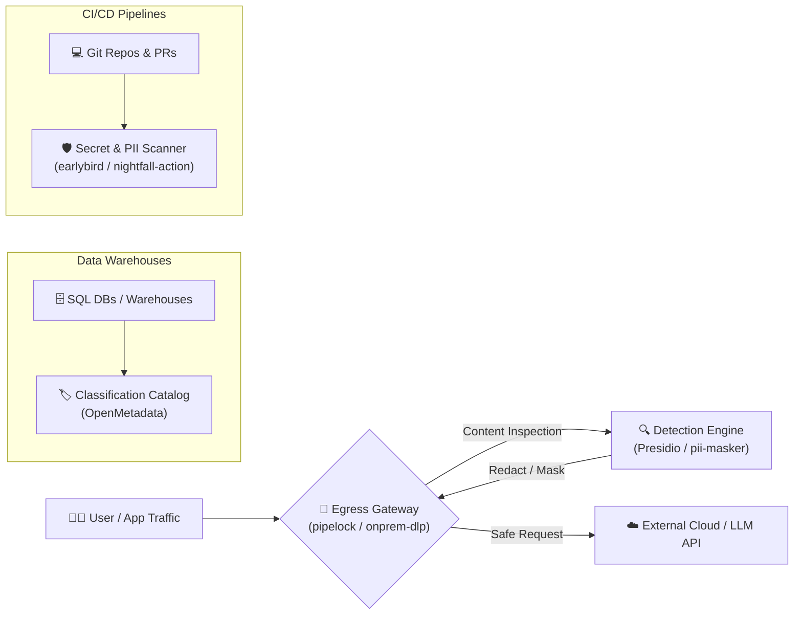

<div align="center">

<p align="center">
  
</p>

# 🛡️ Awesome Data Loss Prevention (DLP)

[](https://github.com/ishandutta2007/Awesome-Awesome-Awesome)
<a href="https://discord.gg/jc4xtF58Ve"></a>
[](http://makeapullrequest.com)
[](LICENSE)
<a href="https://github.com/ishandutta2007"></a>

**A definitive curated list of enterprise SaaS platforms and open-source data security tools for Data Loss Prevention (DLP), PII detection, sensitive data exfiltration control, and AI egress governance.**

🌟 *Star this repository to stay up to date with the latest advances in enterprise data security and open DLP tools!* 🌟

</div>

---

## 📌 Executive Summary & Key Highlights

Data Loss Prevention (DLP) platforms identify, monitor, and protect sensitive data in use (endpoint clipboard/USB/printing), data in motion (network egress/web traffic/email), and data at rest (cloud SaaS, object stores, and databases). With the explosive rise of generative AI assistants (e.g., ChatGPT, Claude Code, Cursor) and automated agentic frameworks, modern DLP has pivoted toward **fragment-level data lineage**, **real-time AI prompt redaction**, and **MCP/API security gateways**.

This directory catalogs both high-scale **commercial SaaS platforms** and self-hosted **open-source security engines** categorized by architectural role, pricing tiers, and community adoption.

---

## 📑 Table of Contents

- [📊 Sector Overview & Market Dynamics](#-sector-overview--market-dynamics)
- [🏢 SaaS/Hosted Enterprise DLP Platforms](#-saashosted-enterprise-dlp-platforms)
- [🔓 Open-Source GitHub Projects](#-open-source-github-projects)
- [🧩 Composing an Open-Source DLP Architecture](#-composing-an-open-source-dlp-architecture)
- [🤝 How to Contribute](#-how-to-contribute)
- [📈 Star History](#-star-history)
- [💖 Support & Sponsorship](#-support--sponsorship)
- [⚖️ Disclaimer](#-disclaimer)

---

## 📊 Sector Overview & Market Dynamics

The global Data Loss Prevention (DLP) market is valued at approximately **$3.5B to $4.3B** and is projected to compound at an **18%–24% CAGR** toward **$13B–$24B+** by the early 2030s. This growth is accelerated by hybrid work adoption, strict global regulatory mandates (GDPR, HIPAA, CCPA, PCI-DSS), and urgent enterprise concerns regarding sensitive intellectual property leaking into third-party Large Language Models (LLMs).

```
┌─────────────────────────────────────────────────────────────────────────────────┐
│                          DLP MARKET STRUCTURE DYNAMICS                          │
├───────────────────────────────────────┬─────────────────────────────────────────┤
│    Enterprise Core (Concentrated)     │      Innovation Edge (Fragmented)       │
├───────────────────────────────────────┼─────────────────────────────────────────┤
│ • Microsoft, Broadcom/Symantec        │ • GenAI Prompt Firewalls & LLM Proxies  │
│ • CrowdStrike, Zscaler, Forcepoint    │ • Developer-first Local PII Redactors   │
│ • Deep multi-channel agent footprint  │ • Fragment-level Data Lineage Trackers  │
│ • Unified SASE, CASB & Email suites   │ • Open-source Egress & Audit Gateways   │
└───────────────────────────────────────┴─────────────────────────────────────────┘
```

The enterprise tier remains **moderately to heavily concentrated** among established cybersecurity titans that bundle DLP inside broader Security Service Edge (SSE), SASE, and Endpoint Detection and Response (EDR) platforms. Conversely, the market periphery is **highly fragmented**, populated by specialized vendors and open-source projects innovating rapidly in AI agent firewalls, contextual NER detection, and instant developer-first redaction.

---

## 🏢 SaaS/Hosted Enterprise DLP Platforms

The table below lists leading commercial SaaS DLP platforms sorted in descending order by parent company scale (valuation / market capitalization):

| 🛡️ Product | 🏛️ Company Scale (Valuation / Revenue) | 💵 Pricing (Specific Starting Tier) | 🎁 Free Tier Limits / Free Trial Limits | 🌐 Channel Coverage & Primary Focus |
| :--- | :--- | :--- | :--- | :--- |
| **[Microsoft Purview DLP](https://www.microsoft.com/purview)** | **~$3.88T Market Cap** (~$245B+ Annual Revenue) | **$12.00/user/month** (M365 E5 Compliance add-on; complete M365 E5 suite at $60.00/user/month) | **Included with M365 E3** (basic sensitivity labels & DLP policies; excludes Insider Risk) / 30-day trial of M365 E5 available (up to 25 user licenses) | Native M365, Teams, SharePoint, OneDrive, and Copilot data boundary governance; requires Defender connectors for 3rd-party SaaS. |
| **[Symantec DLP](https://www.broadcom.com/)** | **~$1.6T Market Cap** (~$51B+ Annual Revenue - Broadcom) | **$1.99/user/year** (Starting tier per SelectHub; ~$14.00/user/year on Capterra) | **No permanent free tier**; 30-day proof-of-concept / evaluation license available via Broadcom partner network | Deep multi-channel enterprise coverage across endpoints, network, email, web traffic, and hybrid cloud storage (AWS, Azure, GCP). |
| **[CrowdStrike Falcon Data Protection](https://www.crowdstrike.com/)** | **~$250B Market Cap** (~$5.84B ARR) | **$73.99/endpoint/year** (CDW Tier 3: 300–499 endpoints; or ~$68.86/endpoint/year on 46-month volume agreement) | **No permanent free tier**; 15-day Falcon platform trial available (limited to endpoint detection / lab agents upon approval) | AI-driven endpoint DLP unified on the Falcon single-agent architecture, monitoring endpoint clipboard, browser, and USB transfers. |
| **[Zscaler DLP](https://www.zscaler.com/)** | **~$40B Market Cap** (~$3.35B Annual Revenue) | **$1,000.00/year** (Starting entry package on AppDirect marketplace; ~$2.00–$5.00/user/month at enterprise volume) | **No permanent free tier**; Custom enterprise evaluation / PoC typically scoped for 14 to 30 days upon sales consultation | Inline zero-trust inspection across cloud web proxy (SWG), CASB, email, SSPM, and generative AI prompt exfiltration controls. |
| **[Proofpoint Enterprise DLP](https://www.proofpoint.com/)** | **$12.3B Valuation** (Thoma Bravo acquisition; ~$1B+ ARR) | **$24.00/user/year** ($2.00/user/month modular entry estimate; SMB Essentials DLP starts at $2.75–$3.93/user/month) | **No permanent free tier**; 30-day guided evaluation / Proof of Concept coordinated through enterprise sales | People-centric DLP covering email gateways, cloud SaaS, endpoints, and insider threat management (ITM). |
| **[Netskope DLP](https://www.netskope.com/)** | **~$6.5B Valuation** (~$899M ARR / ~$709M Revenue - NASDAQ: NTSK) | **$50.00/user/year** (~$4.16/user/month base SWG/CASB starting tier; annual contracts typically start at ~$35,000/year) | **No permanent free tier**; Guided 14 to 30-day Proof of Concept (PoC) scoped for corporate cloud and CASB environments | Cloud-native DLP deeply embedded within Netskope's SASE/SSE architecture, inspecting content and metadata across SaaS and web. |
| **[Forcepoint DLP](https://www.forcepoint.com/)** | **$2.45B Valuation** (carve-out basis; ~$650M Annual Revenue) | **$32.00/user/year** (Baseline compliance licensing starting tier; full IP protection ranges $55–$150+/user/year) | **No permanent free tier**; 14 to 30-day evaluation trial available upon request via enterprise sales | Unified policy engine across web, email, cloud, network, and endpoints with 1,800+ predefined regulatory policies and shadow AI controls. |
| **[Cyberhaven](https://www.cyberhaven.com/)** | **$1.0B Valuation** (Unicorn status; ~$50M+ ARR) | **$30,000.00/year** (Minimum enterprise starting tier contract; translates to ~$4.00–$8.00/user/month at scale) | **No permanent free tier**; 14 to 30-day Proof of Value (PoV) sandbox evaluation offered to qualified enterprise prospects | Patented data lineage tracking at the fragment level; protects sensitive data moving into AI tools, coding assistants (Cursor, Claude Code), and cloud apps. |
| **[Digital Guardian](https://www.digitalguardian.com/)** | **~$500M–$1B Scale** (Parent company Fortra / Thoma Bravo portfolio) | **$60,000.00/year** (Baseline deployment package including management console; minimum 1,000 endpoint threshold) | **No permanent free tier**; 14 to 30-day Proof of Concept (PoC) evaluation coordinated through Fortra sales engineering | Deep kernel-level endpoint inspection, full context tracking, user behavior monitoring, and managed DLP service (MSSP). |
| **[Nightfall AI](https://www.nightfall.ai/)** | **~$150M–$250M Valuation** (~$60M raised; ~$20M+ ARR) | **$48.00/user/year** ($4.00/user/month baseline tier; Nightfall for LLMs custom volume packs) | **Free Developer Tier: 3 GB/month** of scanned data via API; 7-day enterprise Proof of Value (POV) for SaaS and endpoint agents | AI/LLM-native detector utilizing neural NLP models (95% precision) across Slack, Google Drive, Jira, GitHub, endpoints, and GenAI prompts. |

---

## 🔓 Open-Source GitHub Projects

The table below catalogs premier open-source data protection and DLP repositories, ordered descending by GitHub stargazers count:

| 📦 Repository | ⭐ GitHub_Stars | 🎯 Architectural Role & Capabilities | 📜 License |
| :--- | :--- | :--- | :--- |
| **[OpenMetadata](https://github.com/open-metadata/OpenMetadata)** | [](https://github.com/open-metadata/OpenMetadata/stargazers) | **Unified Metadata & Automated PII Classification Platform**: Comprehensive data governance and cataloging engine with integrated sensitive data discovery, automated column profiling, and PII tagging across modern data warehouses. | Apache-2.0 |
| **[Presidio](https://github.com/microsoft/presidio)** | [](https://github.com/microsoft/presidio/stargazers) | **PII Detection and Anonymization Engine**: Microsoft's production-grade framework providing customizable recognizers (regex, NER, checksums) and redactors/maskers for structured and unstructured data. | MIT |
| **[Cybersecurity-Projects (dlp-scanner)](https://github.com/CarterPerez-dev/Cybersecurity-Projects)** | [](https://github.com/CarterPerez-dev/Cybersecurity-Projects/stargazers) | **Multi-Format Data Loss Prevention Scanner**: Educational reference architecture featuring file extractors, sensitive pattern matching algorithms, redaction pipelines, and compliance scoring reporters. | MIT |
| **[pipelock](https://github.com/pipelab-org/pipelock)** | [](https://github.com/pipelab-org/pipelock/stargazers) | **AI Agent Security Gateway & Egress Firewall**: Mediates HTTP, MCP, A2A, and WebSocket agent traffic to detect prompt injections and sensitive data exfiltration before external egress. | Apache-2.0 |
| **[earlybird](https://github.com/americanexpress/earlybird)** | [](https://github.com/americanexpress/earlybird/stargazers) | **Static Source Code Sensitive Data Scanner**: American Express's enterprise scanner for detecting hardcoded secrets, PII, cleartext credentials, and outdated cryptographic implementations in repositories. | Apache-2.0 |
| **[DontFeedTheAI](https://github.com/zeroc00I/DontFeedTheAI)** | [](https://github.com/zeroc00I/DontFeedTheAI/stargazers) | **Transparent LLM Anonymization Proxy**: Intercepts requests destined for cloud LLMs (Claude, OpenAI, OpenRouter) and strips IP addresses, credentials, hostnames, and PII using local Ollama and regex engines. | GPL-3.0 |
| **[pii-masker](https://github.com/HydroXai/pii-masker)** | [](https://github.com/HydroXai/pii-masker/stargazers) | **Transformer-Powered PII Masking Tool**: High-precision sensitive entity detection and masking utility utilizing DeBERTa-v3 to guard privacy in enterprise AI pipelines. | MIT |
| **[openredaction](https://github.com/sam247/openredaction)** | [](https://github.com/sam247/openredaction/stargazers) | **Local-First TypeScript PII Redaction Engine**: Fast, browser- and Node.js-compatible open-source PII detection and redaction library operating 100% on-device. | MIT |
| **[dlp-pdf-redaction](https://github.com/GoogleCloudPlatform/dlp-pdf-redaction)** | [](https://github.com/GoogleCloudPlatform/dlp-pdf-redaction/stargazers) | **Serverless Document Redaction Pipeline**: Cloud Run and Cloud Workflows architecture demonstrating automated visual and text redaction of sensitive PDF data via Google Cloud DLP APIs. | Apache-2.0 |
| **[nightfall_dlp_action](https://github.com/nightfallai/nightfall_dlp_action)** | [](https://github.com/nightfallai/nightfall_dlp_action/stargazers) | **CI/CD Pull Request DLP Action**: Automated GitHub Actions security check scanning pull request diffs for sensitive customer data, PII, and API secrets to prevent repository leaks. | MIT |
| **[BSC_DLP_Community](https://github.com/marianabsctba/BSC_DLP_Community)** | [](https://github.com/marianabsctba/BSC_DLP_Community/stargazers) | **Enterprise Endpoint & Network DLP Platform**: Community edition of an open-source data loss prevention system for discovering, classifying, and enforcing protection policies across network nodes. | GPL-3.0 |
| **[onprem-dlp](https://github.com/portable-genai/onprem-dlp)** | [](https://github.com/portable-genai/onprem-dlp/stargazers) | **Deterministic On-Prem Cloud Egress Gate**: CPU-only DLP gate scrubbing sensitive structured columns and unstructured documents/images before reaching cloud LLMs and APIs via deterministic checksum validators. | Apache-2.0 |

---

## 🧩 Composing an Open-Source DLP Architecture

While comprehensive commercial endpoint DLP suites (like Symantec or CrowdStrike) deploy monolithic device agents, a modular and cost-effective open-source defense can be composed using complementary tools:



- **Data at Rest (Warehouses)**: Deploy **[OpenMetadata](https://github.com/open-metadata/OpenMetadata)** to continuously index schemas, discover PII columns, and maintain compliance data governance tags.
- **Data in CI/CD & Code**: Integrate **[earlybird](https://github.com/americanexpress/earlybird)** or **[nightfall_dlp_action](https://github.com/nightfallai/nightfall_dlp_action)** in pull request workflows to intercept leaked credentials and personal data before committing.
- **Data in Motion (AI & LLM Egress)**: Deploy **[DontFeedTheAI](https://github.com/zeroc00I/DontFeedTheAI)**, **[pipelock](https://github.com/pipelab-org/pipelock)**, or **[onprem-dlp](https://github.com/portable-genai/onprem-dlp)** paired with **[Presidio](https://github.com/microsoft/presidio)** to sanitize prompts before they leave the enterprise perimeter.

---

## 🤝 How to Contribute

Contributions are warmly welcomed! Help keep this directory accurate and up to date:

1. 🍴 **Fork the repository** to your personal GitHub account.
2. 🌿 **Create a new branch** (`git checkout -b add-dlp-tool`).
3. ✏️ **Add or update entries** in `README.md` maintaining table formatting, specific starting tier pricing, free tier/trial limits, and valid license identifiers.
4. 🚀 **Submit a Pull Request** with a succinct explanation of your additions or edits.

---

## 📈 Star History

[](https://star-history.dera.page/#ishandutta2007/Awesome-Data-Loss-Prevention-DLP&type=date&legend=top-left)

---

## 💖 Support & Sponsorship

If you find this curated Data Loss Prevention guide useful, please consider:
- ⭐ **Starring this repository** on GitHub.
- 🍴 **Forking it** to share with your security engineering colleagues.
- ☕ **Buying a coffee & sponsoring ongoing maintenance**: Support development directly via the [GitHub Sponsor Dashboard](https://github.com/sponsors/ishandutta2007).

Thank you for contributing to an open, resilient, and egress-aware data security ecosystem! 🙌

---

## ⚖️ Disclaimer

- This curated list is maintained by the open-source community for informational and architectural research purposes only; inclusion does not constitute commercial endorsement.
- All enterprise DLP deployments must undergo proper compliance validation with relevant regulatory frameworks (GDPR, HIPAA, CCPA, PCI-DSS, SOC 2).
- All registered trademarks, logos, and company names belong strictly to their respective owners.

---

<div align="center">
  <b>Built with ❤️ for cybersecurity engineers, privacy architects, and data protection teams.</b>
</div>
